<div align="center">




</div>

```console
ryu@s3c:~$ ./recon.sh --target self

[*] Initializing recon on RYU_S3C ...
[+] Role ............ Information Security Engineer
[+] Sector .......... Finance / Securities / Digital assets
[+] Base ............ Hanoi, VN
[+] Ops history ..... dev  ->  security engineer  ->  blue team  ->  policy & compliance
[*] Pivoting to ..... AppSec / Web Pentest / Red Team AD
[!] Status .......... still learning. still hunting.
```

```console
ryu@s3c:~$ ls -la ./labs

drwx------  ad-attack-defense/     # kerberoast, ACL abuse, detection rules
drwx------  ir-practice/           # webshell, reverse shell, triage
drwx------  owasp-top10-lab/       # vulnerable fintech app, attack <-> fix
drwx------  phishing-sim/          # gophish campaigns
drwx------  soar-wazuh/            # detection + auto response
drwx------  splunk-siem/           # log pipeline, SPL hunting
```

### `> arsenal`


### `> activity`

<picture>
  <source media="(prefers-color-scheme: dark)" srcset="https://raw.githubusercontent.com/longht0911/longht0911/output/snake-dark.svg" />
  
</picture>

### `> writeups`

```text
[ coming soon ]  HTB / THM machines, web pentest notes, AD attack paths
```

### `> contact`


<div align="center"><sub><code>// no system is safe — only patched</code></sub></div>
